# V6 核心的論文結果重現（方法有調整）

本輪為同 cohort 的探索性重跑。T 是 V6 lesion∩AAL3 加 availability；Fwhole 是 V5 完整腦區 Original 特徵對照。兩者都不能標示為原稿全濾波器 F 的逐字重現。C 使用保守臨床欄位；S 僅 AAL3 burden；R 為重抽 Original 病灶 radiomics。

表 4.2–4.5 對應各任務的 classifier CSV；表 4.6 為篩選法比較；表 4.7 為固定組合。backward 依原 notebook 實作為 single-fit top-k。所有比較固定列出，不以 outer 分數挑選後宣稱獨立驗證。

SHAP 為 held-out TreeSHAP、raw log odds，使用包含 training-only SMOTE 的訓練樹路徑背景。每人三次 held-out 解釋；未入選特徵貢獻設零。腦區圖把同區特徵的平均絕對 SHAP 加總，availability 與 radiomics 分開，不代表因果或經確認的生物機制。

AUC 使用每人三次 OOF 平均；另提供 mean-repeat AUC。bootstrap 為固定 OOF 的配對病人抽樣，不包含重訓或跨版本選擇不確定性。

| 任務 | n | T AUC | whole-region F AUC | C+R+S+T AUC |
|---|---:|---:|---:|---:|
| mRS | 191 | 0.616 | 0.658 | 0.762 |
| NIHSS | 192 | 0.625 | 0.679 | 0.712 |
| TE | 196 | 0.554 | 0.610 | 0.645 |
| LVO | 196 | 0.608 | 0.582 | 0.734 |

## 已完成的 V6 核心精確重跑

[核心結果與配對增量](core/RESULTS.md)｜[核心指標 CSV](core/core_results.csv)｜[精確重跑稽核](core/reproduction_audit.json)

核心 V1_base_T 與此處 T+C+R+S 不是相同模型：核心另含體積、global availability，且各分支保留數不同，不可混用其數字或解釋圖。

## 指標與下載

- [全部方法指標](all_metrics.csv)：AUROC、AUPRC（average precision）、accuracy、sensitivity、specificity、Brier、AUROC 95% CI 與 mean-repeat AUROC。
- 分類指標固定使用 0.5 閾值；未使用測試結局挑閾值。ΔAUC 欄位以該表 reference 指定的模型比較，不能視為所有模型間的增量。
- [樣本數與標籤分布](cohort_counts.csv)｜[表 4.6：篩選法](table_4_6_selection.csv)｜[表 4.7：特徵組合](table_4_7_combinations.csv)｜[稽核紀錄](independent_audit.json)

## 各任務結果與圖表

### mRS

[全部指標](mRS_summary.csv)｜[逐次 CV 指標](mRS_repeat_metrics.csv)｜[逐人 OOF](mRS_oof_predictions.csv)｜[分類器比較表](mRS_table_4_2_to_4_5.csv)

| 方法 | AUC（conditional 95% CI） | AUPRC | Accuracy | Sensitivity | Specificity | Brier |
|---|---|---:|---:|---:|---:|---:|
| CatBoost_RFE_C | 0.649 [0.568, 0.727] | 0.590 | 0.639 | 0.475 | 0.757 | 0.245 |
| CatBoost_RFE_Fwhole | 0.648 [0.565, 0.725] | 0.614 | 0.654 | 0.450 | 0.802 | 0.238 |
| CatBoost_RFE_R | 0.652 [0.570, 0.730] | 0.596 | 0.654 | 0.450 | 0.802 | 0.236 |
| CatBoost_RFE_S | 0.601 [0.516, 0.682] | 0.539 | 0.607 | 0.400 | 0.757 | 0.243 |
| CatBoost_RFE_T | 0.556 [0.473, 0.636] | 0.484 | 0.581 | 0.312 | 0.775 | 0.246 |
| LightGBM_RFE_C | 0.650 [0.567, 0.729] | 0.618 | 0.623 | 0.487 | 0.721 | 0.226 |
| LightGBM_RFE_Fwhole | 0.658 [0.576, 0.735] | 0.612 | 0.670 | 0.562 | 0.748 | 0.233 |
| LightGBM_RFE_Fwhole_C | 0.665 [0.586, 0.740] | 0.629 | 0.670 | 0.562 | 0.748 | 0.229 |
| LightGBM_RFE_Fwhole_C_R | 0.676 [0.595, 0.750] | 0.643 | 0.660 | 0.537 | 0.748 | 0.226 |
| LightGBM_RFE_Fwhole_C_R_S | 0.678 [0.599, 0.752] | 0.633 | 0.670 | 0.525 | 0.775 | 0.225 |
| LightGBM_RFE_Fwhole_R | 0.673 [0.593, 0.748] | 0.624 | 0.634 | 0.512 | 0.721 | 0.229 |
| LightGBM_RFE_Fwhole_S | 0.656 [0.576, 0.734] | 0.616 | 0.654 | 0.537 | 0.739 | 0.233 |
| LightGBM_RFE_R | 0.655 [0.575, 0.733] | 0.590 | 0.660 | 0.525 | 0.757 | 0.229 |
| LightGBM_RFE_S | 0.644 [0.564, 0.724] | 0.568 | 0.623 | 0.537 | 0.685 | 0.229 |
| LightGBM_RFE_T | 0.616 [0.532, 0.697] | 0.550 | 0.618 | 0.537 | 0.676 | 0.236 |
| LightGBM_RFE_T_C | 0.707 [0.626, 0.783] | 0.654 | 0.681 | 0.512 | 0.802 | 0.211 |
| LightGBM_RFE_T_C_R | 0.742 [0.669, 0.812] | 0.694 | 0.702 | 0.588 | 0.784 | 0.201 |
| LightGBM_RFE_T_C_R_S | 0.762 [0.691, 0.830] | 0.714 | 0.733 | 0.650 | 0.793 | 0.193 |
| LightGBM_RFE_T_R | 0.659 [0.578, 0.740] | 0.601 | 0.675 | 0.537 | 0.775 | 0.226 |
| LightGBM_RFE_T_S | 0.642 [0.560, 0.721] | 0.569 | 0.607 | 0.512 | 0.676 | 0.229 |
| LightGBM_RFE_flags | 0.614 [0.530, 0.695] | 0.552 | 0.613 | 0.525 | 0.676 | 0.235 |
| LightGBM_backward_C | 0.650 [0.567, 0.729] | 0.618 | 0.623 | 0.487 | 0.721 | 0.226 |
| LightGBM_backward_Fwhole | 0.679 [0.601, 0.758] | 0.640 | 0.670 | 0.562 | 0.748 | 0.224 |
| LightGBM_backward_R | 0.645 [0.565, 0.724] | 0.570 | 0.660 | 0.512 | 0.766 | 0.233 |
| LightGBM_backward_S | 0.639 [0.559, 0.718] | 0.565 | 0.618 | 0.537 | 0.676 | 0.230 |
| LightGBM_backward_T | 0.619 [0.537, 0.702] | 0.556 | 0.628 | 0.550 | 0.685 | 0.234 |
| RF_RFE_C | 0.705 [0.626, 0.777] | 0.611 | 0.649 | 0.487 | 0.766 | 0.217 |
| RF_RFE_Fwhole | 0.642 [0.555, 0.722] | 0.599 | 0.649 | 0.500 | 0.757 | 0.231 |
| RF_RFE_R | 0.643 [0.559, 0.722] | 0.588 | 0.644 | 0.463 | 0.775 | 0.228 |
| RF_RFE_S | 0.604 [0.520, 0.687] | 0.565 | 0.586 | 0.412 | 0.712 | 0.236 |
| RF_RFE_T | 0.556 [0.471, 0.638] | 0.522 | 0.592 | 0.325 | 0.784 | 0.246 |
| XGBoost_RFE_C | 0.650 [0.569, 0.727] | 0.583 | 0.634 | 0.512 | 0.721 | 0.227 |
| XGBoost_RFE_Fwhole | 0.640 [0.561, 0.718] | 0.605 | 0.613 | 0.512 | 0.685 | 0.230 |
| XGBoost_RFE_R | 0.630 [0.545, 0.709] | 0.575 | 0.660 | 0.500 | 0.775 | 0.231 |
| XGBoost_RFE_S | 0.601 [0.523, 0.680] | 0.499 | 0.581 | 0.362 | 0.739 | 0.242 |
| XGBoost_RFE_T | 0.613 [0.535, 0.689] | 0.543 | 0.597 | 0.338 | 0.784 | 0.235 |

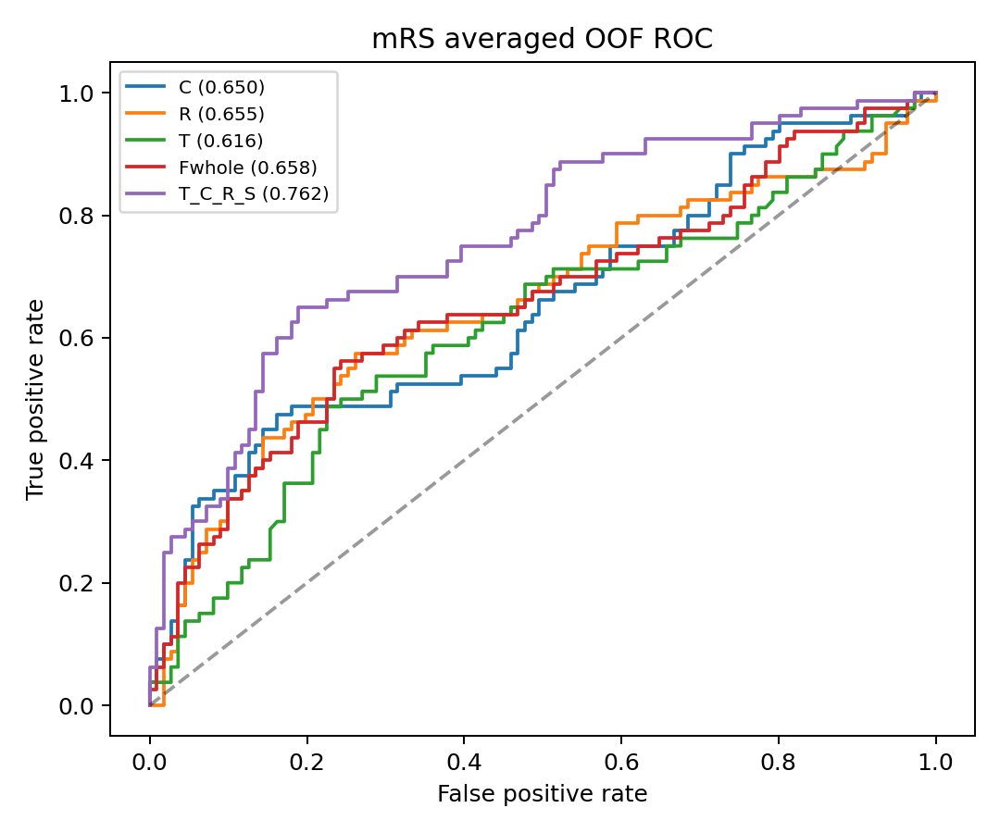

#### C 的 held-out SHAP

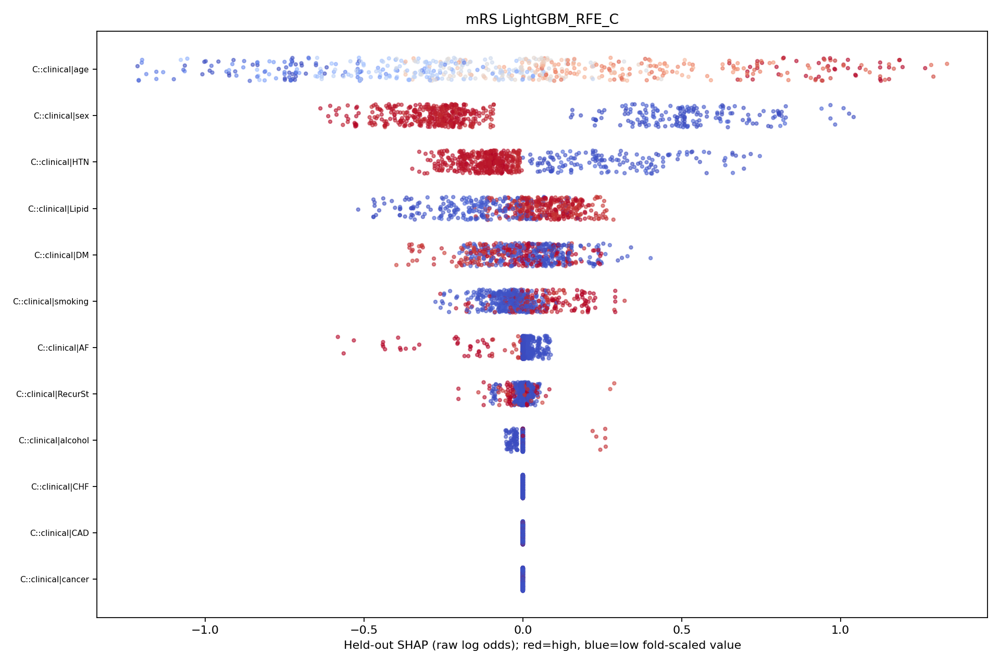

[特徵重要性與入選頻率](mRS_LightGBM_RFE_C_importance.csv)

#### R 的 held-out SHAP

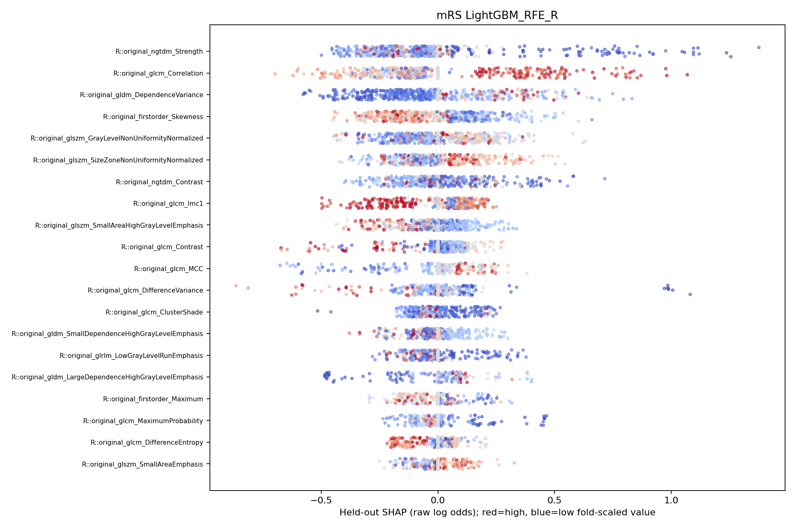

[特徵重要性與入選頻率](mRS_LightGBM_RFE_R_importance.csv)

#### S 的 held-out SHAP

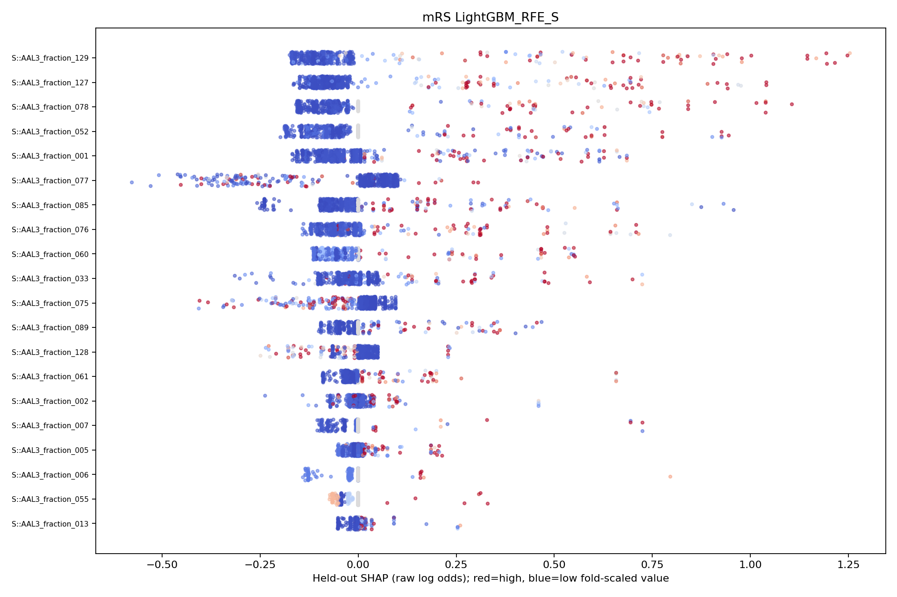

[特徵重要性與入選頻率](mRS_LightGBM_RFE_S_importance.csv)

#### T 的 held-out SHAP

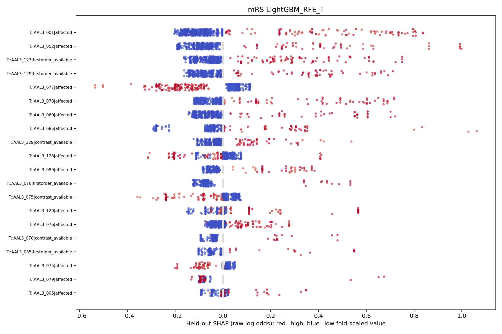

[特徵重要性與入選頻率](mRS_LightGBM_RFE_T_importance.csv)

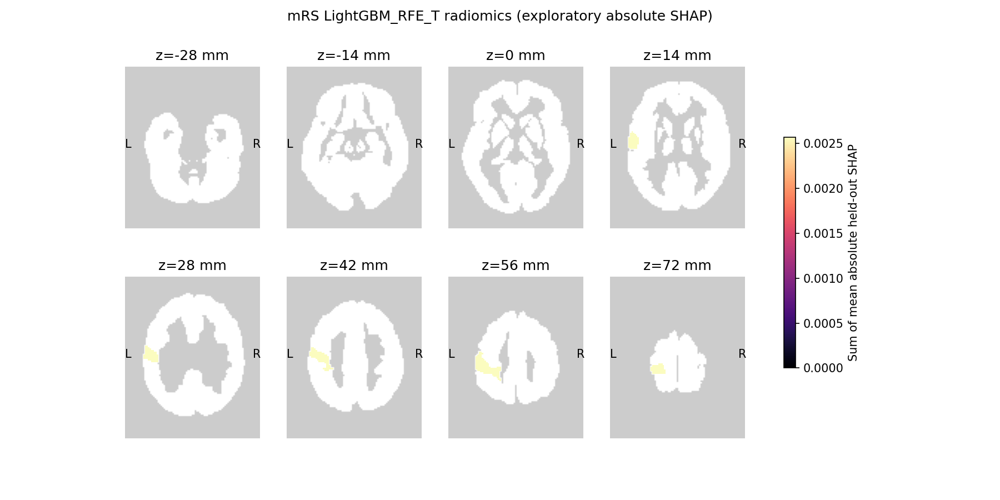

[腦區數值](mRS_LightGBM_RFE_T_radiomics_regions.csv)｜[NIfTI 圖譜](mRS_LightGBM_RFE_T_radiomics_atlas.nii.gz)

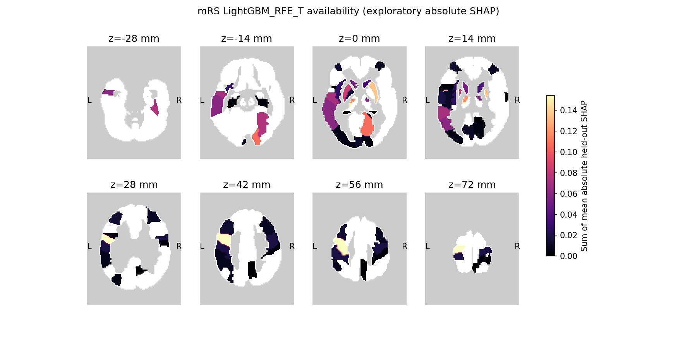

[腦區數值](mRS_LightGBM_RFE_T_availability_regions.csv)｜[NIfTI 圖譜](mRS_LightGBM_RFE_T_availability_atlas.nii.gz)

#### Fwhole 的 held-out SHAP

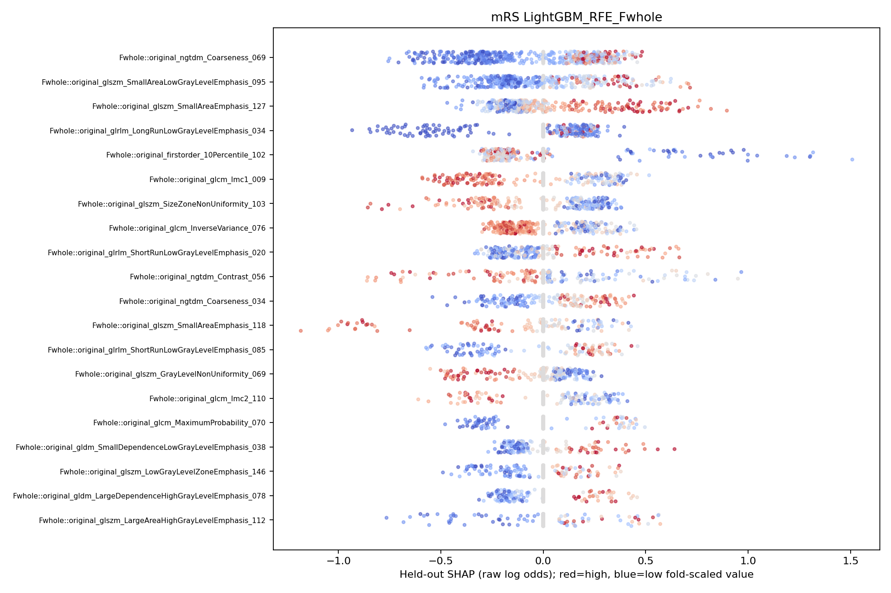

[特徵重要性與入選頻率](mRS_LightGBM_RFE_Fwhole_importance.csv)

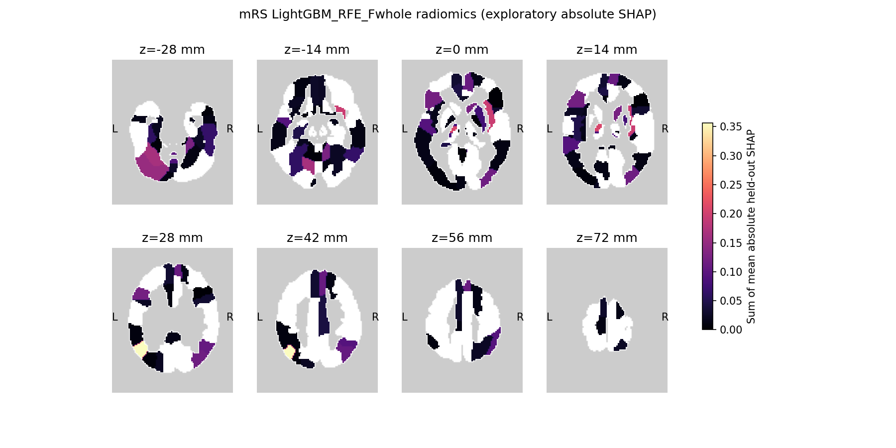

[腦區數值](mRS_LightGBM_RFE_Fwhole_radiomics_regions.csv)｜[NIfTI 圖譜](mRS_LightGBM_RFE_Fwhole_radiomics_atlas.nii.gz)

### NIHSS

[全部指標](NIHSS_summary.csv)｜[逐次 CV 指標](NIHSS_repeat_metrics.csv)｜[逐人 OOF](NIHSS_oof_predictions.csv)｜[分類器比較表](NIHSS_table_4_2_to_4_5.csv)

| 方法 | AUC（conditional 95% CI） | AUPRC | Accuracy | Sensitivity | Specificity | Brier |
|---|---|---:|---:|---:|---:|---:|
| CatBoost_RFE_C | 0.504 [0.416, 0.587] | 0.428 | 0.562 | 0.436 | 0.649 | 0.250 |
| CatBoost_RFE_Fwhole | 0.634 [0.550, 0.711] | 0.591 | 0.615 | 0.436 | 0.737 | 0.238 |
| CatBoost_RFE_R | 0.705 [0.628, 0.777] | 0.636 | 0.682 | 0.526 | 0.789 | 0.229 |
| CatBoost_RFE_S | 0.618 [0.530, 0.707] | 0.606 | 0.693 | 0.487 | 0.833 | 0.238 |
| CatBoost_RFE_T | 0.653 [0.568, 0.735] | 0.605 | 0.667 | 0.410 | 0.842 | 0.238 |
| LightGBM_RFE_C | 0.491 [0.402, 0.578] | 0.427 | 0.526 | 0.436 | 0.588 | 0.264 |
| LightGBM_RFE_Fwhole | 0.679 [0.595, 0.753] | 0.649 | 0.651 | 0.462 | 0.781 | 0.217 |
| LightGBM_RFE_Fwhole_C | 0.695 [0.612, 0.767] | 0.668 | 0.651 | 0.474 | 0.772 | 0.212 |
| LightGBM_RFE_Fwhole_C_R | 0.697 [0.613, 0.767] | 0.668 | 0.661 | 0.474 | 0.789 | 0.212 |
| LightGBM_RFE_Fwhole_C_R_S | 0.705 [0.625, 0.774] | 0.677 | 0.667 | 0.487 | 0.789 | 0.207 |
| LightGBM_RFE_Fwhole_R | 0.696 [0.613, 0.766] | 0.659 | 0.661 | 0.487 | 0.781 | 0.213 |
| LightGBM_RFE_Fwhole_S | 0.691 [0.609, 0.763] | 0.658 | 0.646 | 0.474 | 0.763 | 0.216 |
| LightGBM_RFE_R | 0.709 [0.630, 0.780] | 0.653 | 0.651 | 0.526 | 0.737 | 0.209 |
| LightGBM_RFE_S | 0.627 [0.540, 0.715] | 0.586 | 0.641 | 0.513 | 0.728 | 0.229 |
| LightGBM_RFE_T | 0.625 [0.540, 0.710] | 0.563 | 0.604 | 0.500 | 0.675 | 0.233 |
| LightGBM_RFE_T_C | 0.610 [0.523, 0.695] | 0.556 | 0.573 | 0.397 | 0.693 | 0.236 |
| LightGBM_RFE_T_C_R | 0.714 [0.638, 0.786] | 0.654 | 0.635 | 0.449 | 0.763 | 0.208 |
| LightGBM_RFE_T_C_R_S | 0.712 [0.634, 0.788] | 0.669 | 0.688 | 0.513 | 0.807 | 0.208 |
| LightGBM_RFE_T_R | 0.691 [0.611, 0.765] | 0.651 | 0.651 | 0.513 | 0.746 | 0.212 |
| LightGBM_RFE_T_S | 0.626 [0.539, 0.713] | 0.583 | 0.635 | 0.538 | 0.702 | 0.229 |
| LightGBM_RFE_flags | 0.625 [0.540, 0.710] | 0.564 | 0.625 | 0.513 | 0.702 | 0.232 |
| LightGBM_backward_C | 0.491 [0.402, 0.578] | 0.427 | 0.526 | 0.436 | 0.588 | 0.264 |
| LightGBM_backward_Fwhole | 0.673 [0.592, 0.745] | 0.640 | 0.635 | 0.474 | 0.746 | 0.221 |
| LightGBM_backward_R | 0.719 [0.641, 0.789] | 0.657 | 0.667 | 0.513 | 0.772 | 0.205 |
| LightGBM_backward_S | 0.627 [0.539, 0.713] | 0.588 | 0.646 | 0.526 | 0.728 | 0.229 |
| LightGBM_backward_T | 0.622 [0.537, 0.708] | 0.556 | 0.609 | 0.513 | 0.675 | 0.233 |
| RF_RFE_C | 0.542 [0.456, 0.626] | 0.458 | 0.557 | 0.397 | 0.667 | 0.248 |
| RF_RFE_Fwhole | 0.652 [0.567, 0.729] | 0.632 | 0.620 | 0.462 | 0.728 | 0.225 |
| RF_RFE_R | 0.708 [0.631, 0.778] | 0.640 | 0.656 | 0.487 | 0.772 | 0.209 |
| RF_RFE_S | 0.616 [0.528, 0.703] | 0.617 | 0.688 | 0.474 | 0.833 | 0.220 |
| RF_RFE_T | 0.648 [0.563, 0.727] | 0.637 | 0.667 | 0.410 | 0.842 | 0.214 |
| XGBoost_RFE_C | 0.515 [0.431, 0.599] | 0.438 | 0.536 | 0.385 | 0.640 | 0.256 |
| XGBoost_RFE_Fwhole | 0.687 [0.605, 0.760] | 0.608 | 0.609 | 0.474 | 0.702 | 0.217 |
| XGBoost_RFE_R | 0.697 [0.619, 0.770] | 0.630 | 0.635 | 0.487 | 0.737 | 0.211 |
| XGBoost_RFE_S | 0.568 [0.480, 0.657] | 0.556 | 0.682 | 0.436 | 0.851 | 0.233 |
| XGBoost_RFE_T | 0.600 [0.515, 0.688] | 0.593 | 0.667 | 0.423 | 0.833 | 0.225 |

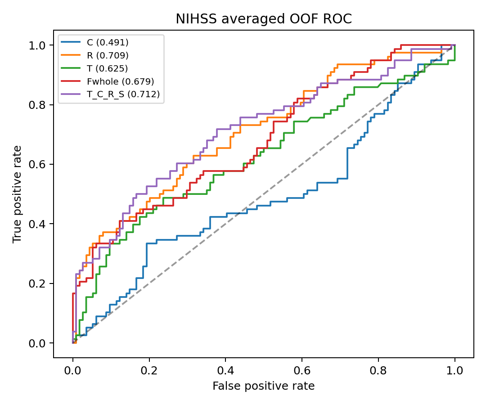

#### C 的 held-out SHAP

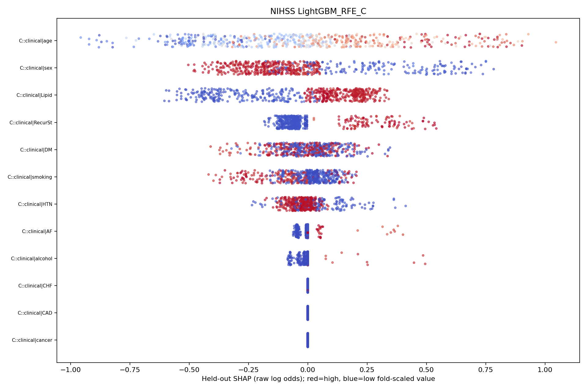

[特徵重要性與入選頻率](NIHSS_LightGBM_RFE_C_importance.csv)

#### R 的 held-out SHAP

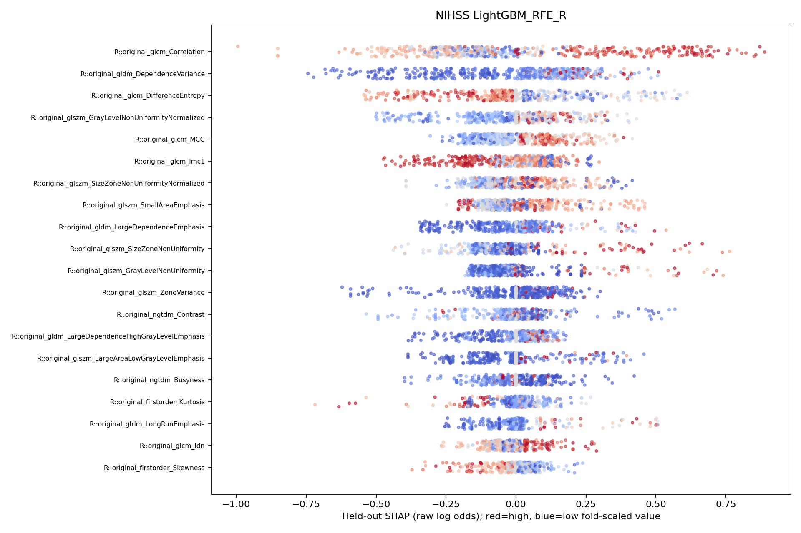

[特徵重要性與入選頻率](NIHSS_LightGBM_RFE_R_importance.csv)

#### S 的 held-out SHAP

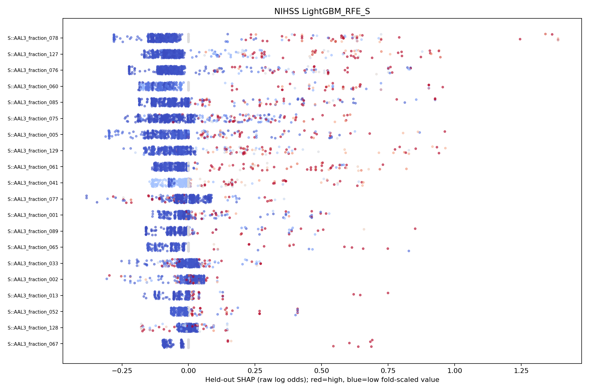

[特徵重要性與入選頻率](NIHSS_LightGBM_RFE_S_importance.csv)

#### T 的 held-out SHAP

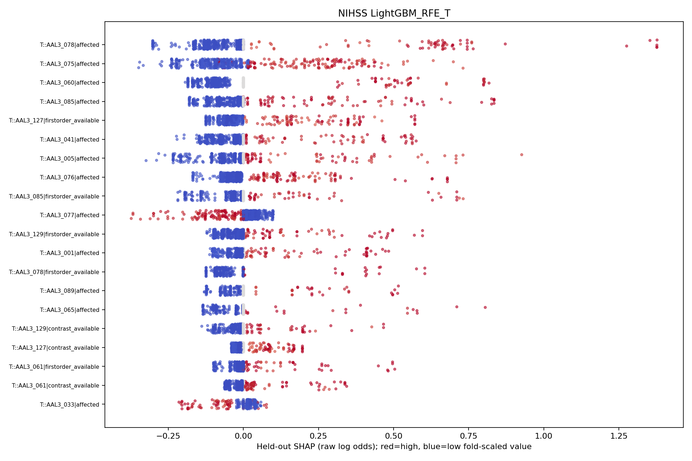

[特徵重要性與入選頻率](NIHSS_LightGBM_RFE_T_importance.csv)

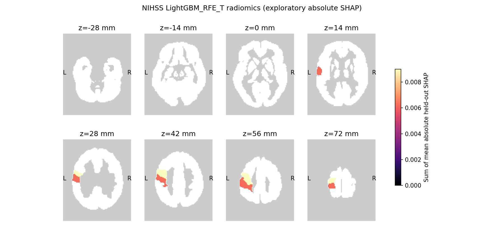

[腦區數值](NIHSS_LightGBM_RFE_T_radiomics_regions.csv)｜[NIfTI 圖譜](NIHSS_LightGBM_RFE_T_radiomics_atlas.nii.gz)

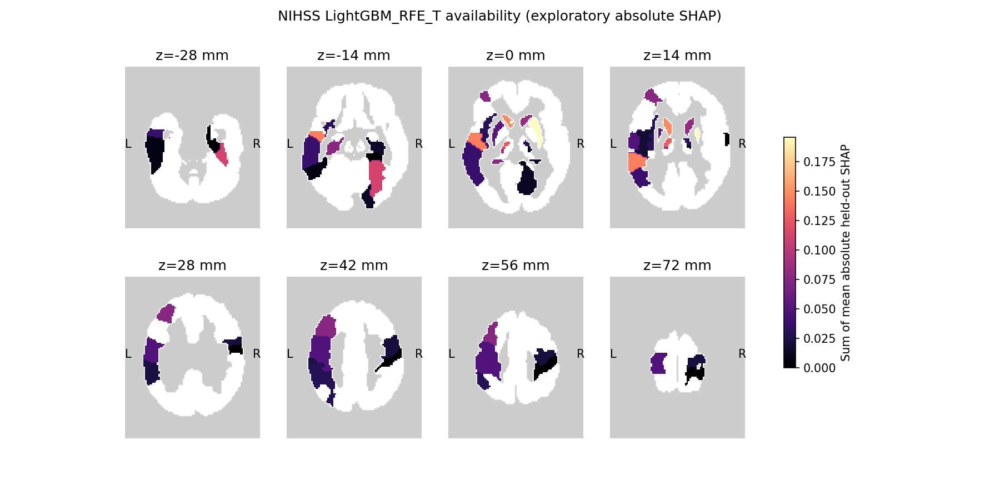

[腦區數值](NIHSS_LightGBM_RFE_T_availability_regions.csv)｜[NIfTI 圖譜](NIHSS_LightGBM_RFE_T_availability_atlas.nii.gz)

#### Fwhole 的 held-out SHAP

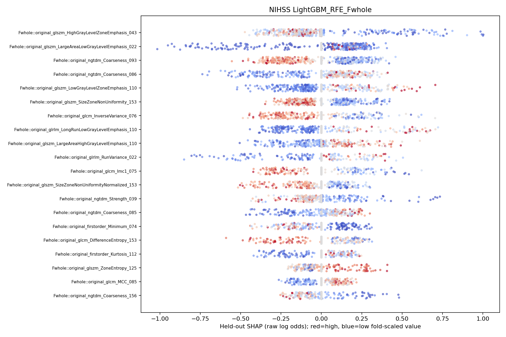

[特徵重要性與入選頻率](NIHSS_LightGBM_RFE_Fwhole_importance.csv)

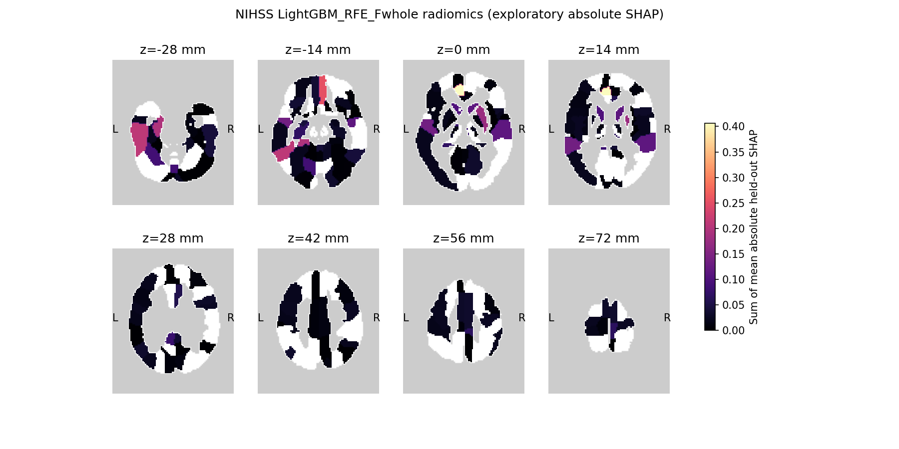

[腦區數值](NIHSS_LightGBM_RFE_Fwhole_radiomics_regions.csv)｜[NIfTI 圖譜](NIHSS_LightGBM_RFE_Fwhole_radiomics_atlas.nii.gz)

### TE

[全部指標](TE_summary.csv)｜[逐次 CV 指標](TE_repeat_metrics.csv)｜[逐人 OOF](TE_oof_predictions.csv)｜[分類器比較表](TE_table_4_2_to_4_5.csv)

| 方法 | AUC（conditional 95% CI） | AUPRC | Accuracy | Sensitivity | Specificity | Brier |
|---|---|---:|---:|---:|---:|---:|
| CatBoost_RFE_C | 0.562 [0.467, 0.660] | 0.227 | 0.622 | 0.421 | 0.671 | 0.245 |
| CatBoost_RFE_Fwhole | 0.636 [0.542, 0.725] | 0.253 | 0.714 | 0.211 | 0.835 | 0.228 |
| CatBoost_RFE_R | 0.594 [0.490, 0.695] | 0.253 | 0.668 | 0.447 | 0.722 | 0.229 |
| CatBoost_RFE_S | 0.514 [0.402, 0.625] | 0.228 | 0.730 | 0.289 | 0.835 | 0.232 |
| CatBoost_RFE_T | 0.594 [0.473, 0.713] | 0.430 | 0.755 | 0.368 | 0.848 | 0.229 |
| LightGBM_RFE_C | 0.591 [0.492, 0.688] | 0.237 | 0.663 | 0.316 | 0.747 | 0.206 |
| LightGBM_RFE_Fwhole | 0.610 [0.507, 0.708] | 0.303 | 0.750 | 0.184 | 0.886 | 0.170 |
| LightGBM_RFE_Fwhole_C | 0.609 [0.506, 0.709] | 0.285 | 0.781 | 0.211 | 0.918 | 0.168 |
| LightGBM_RFE_Fwhole_C_R | 0.618 [0.518, 0.717] | 0.309 | 0.770 | 0.237 | 0.899 | 0.167 |
| LightGBM_RFE_Fwhole_C_R_S | 0.616 [0.516, 0.716] | 0.330 | 0.796 | 0.263 | 0.924 | 0.166 |
| LightGBM_RFE_Fwhole_R | 0.614 [0.514, 0.712] | 0.321 | 0.786 | 0.237 | 0.918 | 0.167 |
| LightGBM_RFE_Fwhole_S | 0.607 [0.506, 0.707] | 0.282 | 0.765 | 0.184 | 0.905 | 0.170 |
| LightGBM_RFE_R | 0.628 [0.527, 0.725] | 0.279 | 0.679 | 0.447 | 0.734 | 0.200 |
| LightGBM_RFE_S | 0.593 [0.502, 0.682] | 0.233 | 0.699 | 0.263 | 0.804 | 0.194 |
| LightGBM_RFE_T | 0.554 [0.463, 0.646] | 0.211 | 0.668 | 0.184 | 0.785 | 0.203 |
| LightGBM_RFE_T_C | 0.620 [0.522, 0.712] | 0.279 | 0.770 | 0.237 | 0.899 | 0.169 |
| LightGBM_RFE_T_C_R | 0.655 [0.553, 0.749] | 0.307 | 0.760 | 0.289 | 0.873 | 0.167 |
| LightGBM_RFE_T_C_R_S | 0.645 [0.543, 0.738] | 0.306 | 0.760 | 0.211 | 0.892 | 0.169 |
| LightGBM_RFE_T_R | 0.590 [0.489, 0.691] | 0.267 | 0.724 | 0.316 | 0.823 | 0.192 |
| LightGBM_RFE_T_S | 0.570 [0.480, 0.658] | 0.219 | 0.668 | 0.211 | 0.778 | 0.197 |
| LightGBM_RFE_flags | 0.545 [0.458, 0.636] | 0.204 | 0.684 | 0.158 | 0.810 | 0.202 |
| LightGBM_backward_C | 0.591 [0.492, 0.688] | 0.237 | 0.663 | 0.316 | 0.747 | 0.206 |
| LightGBM_backward_Fwhole | 0.617 [0.519, 0.712] | 0.273 | 0.755 | 0.263 | 0.873 | 0.174 |
| LightGBM_backward_R | 0.621 [0.518, 0.717] | 0.271 | 0.668 | 0.447 | 0.722 | 0.202 |
| LightGBM_backward_S | 0.602 [0.512, 0.692] | 0.244 | 0.689 | 0.237 | 0.797 | 0.191 |
| LightGBM_backward_T | 0.544 [0.453, 0.636] | 0.201 | 0.668 | 0.184 | 0.785 | 0.206 |
| RF_RFE_C | 0.604 [0.511, 0.694] | 0.242 | 0.673 | 0.342 | 0.753 | 0.204 |
| RF_RFE_Fwhole | 0.594 [0.503, 0.686] | 0.235 | 0.714 | 0.211 | 0.835 | 0.190 |
| RF_RFE_R | 0.561 [0.460, 0.663] | 0.223 | 0.648 | 0.395 | 0.709 | 0.223 |
| RF_RFE_S | 0.537 [0.430, 0.644] | 0.229 | 0.679 | 0.237 | 0.785 | 0.205 |
| RF_RFE_T | 0.585 [0.474, 0.696] | 0.302 | 0.760 | 0.368 | 0.854 | 0.198 |
| XGBoost_RFE_C | 0.544 [0.447, 0.640] | 0.208 | 0.633 | 0.263 | 0.722 | 0.210 |
| XGBoost_RFE_Fwhole | 0.636 [0.547, 0.725] | 0.292 | 0.730 | 0.184 | 0.861 | 0.173 |
| XGBoost_RFE_R | 0.586 [0.478, 0.695] | 0.278 | 0.684 | 0.421 | 0.747 | 0.202 |
| XGBoost_RFE_S | 0.466 [0.364, 0.568] | 0.185 | 0.679 | 0.132 | 0.810 | 0.207 |
| XGBoost_RFE_T | 0.525 [0.412, 0.632] | 0.228 | 0.714 | 0.237 | 0.829 | 0.203 |

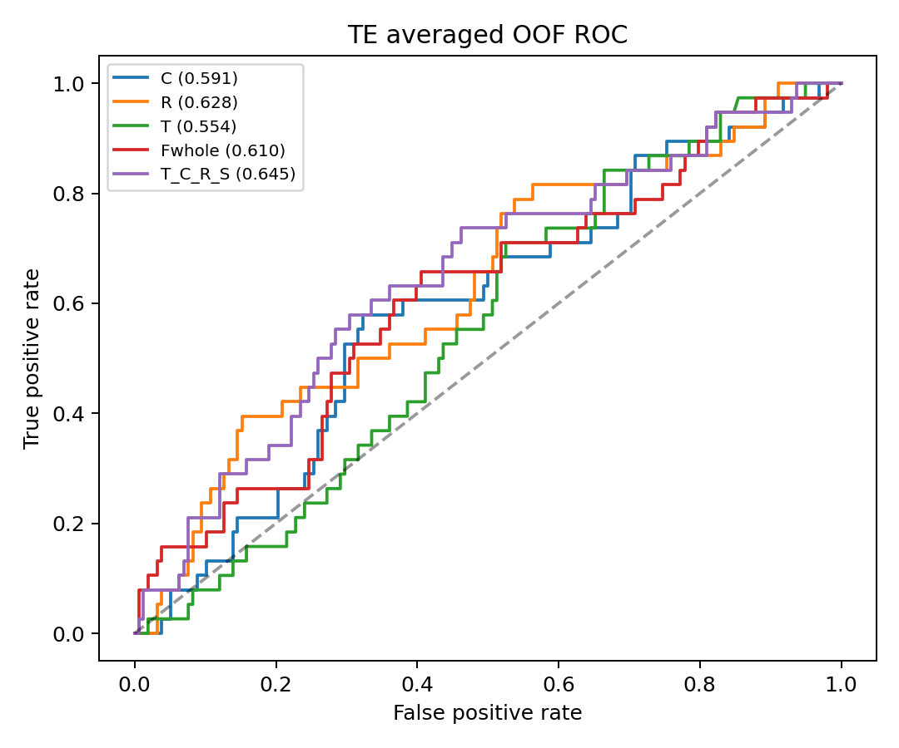

#### C 的 held-out SHAP

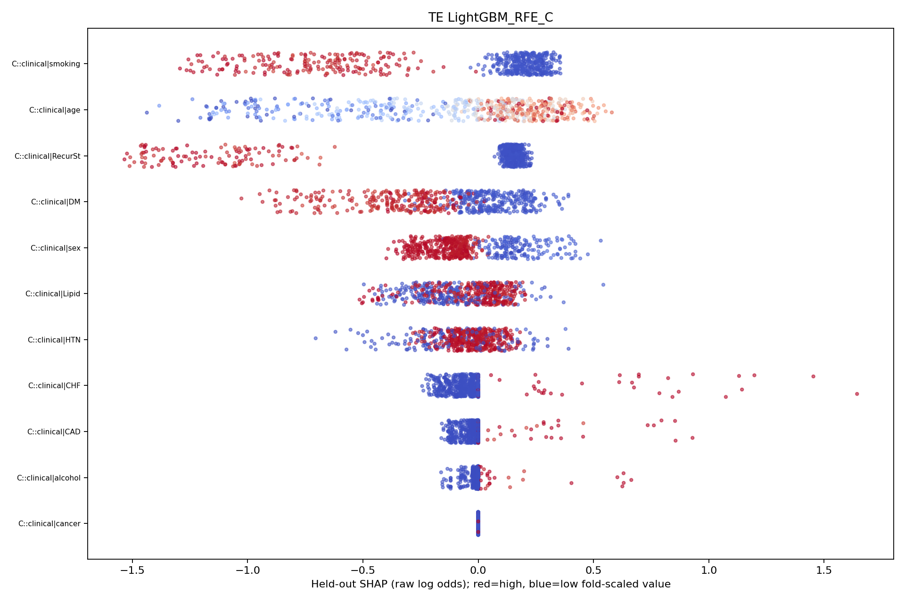

[特徵重要性與入選頻率](TE_LightGBM_RFE_C_importance.csv)

#### R 的 held-out SHAP

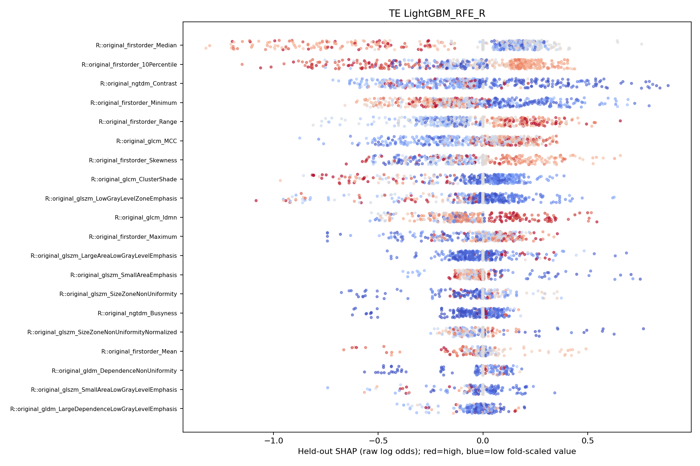

[特徵重要性與入選頻率](TE_LightGBM_RFE_R_importance.csv)

#### S 的 held-out SHAP

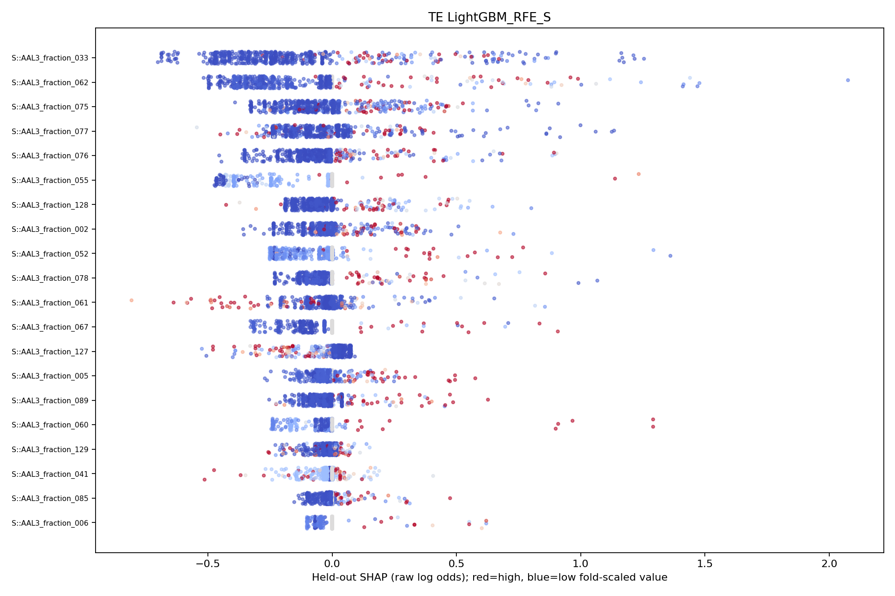

[特徵重要性與入選頻率](TE_LightGBM_RFE_S_importance.csv)

#### T 的 held-out SHAP

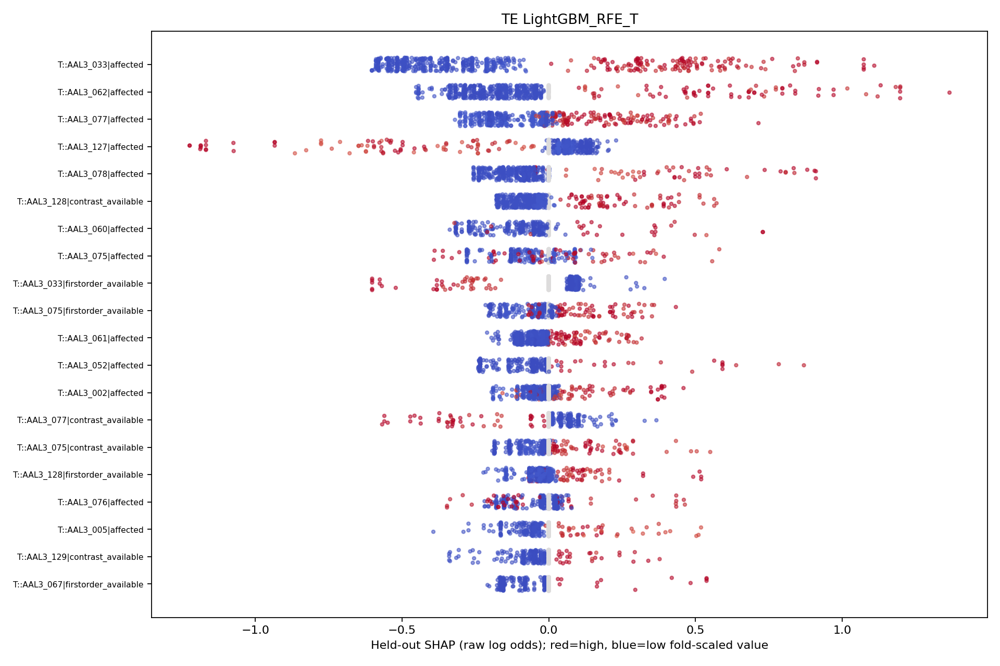

[特徵重要性與入選頻率](TE_LightGBM_RFE_T_importance.csv)

[腦區數值](TE_LightGBM_RFE_T_radiomics_regions.csv)｜[NIfTI 圖譜](TE_LightGBM_RFE_T_radiomics_atlas.nii.gz)

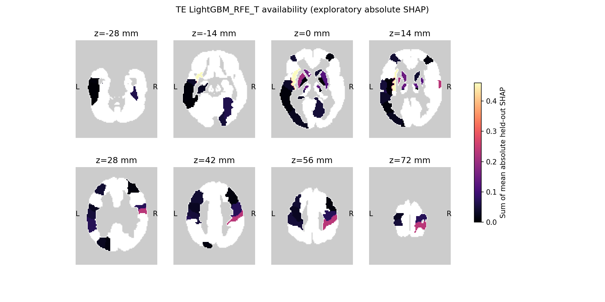

[腦區數值](TE_LightGBM_RFE_T_availability_regions.csv)｜[NIfTI 圖譜](TE_LightGBM_RFE_T_availability_atlas.nii.gz)

#### Fwhole 的 held-out SHAP

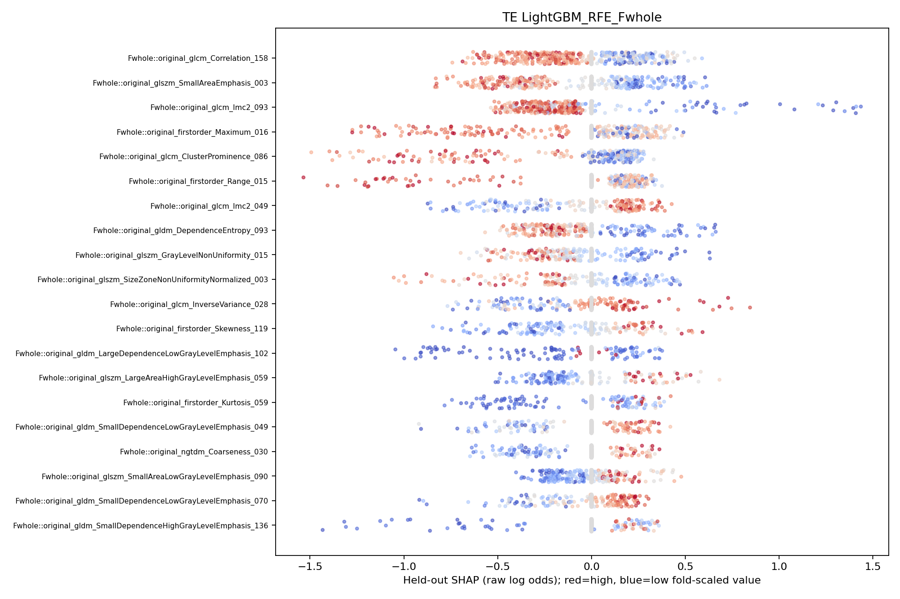

[特徵重要性與入選頻率](TE_LightGBM_RFE_Fwhole_importance.csv)

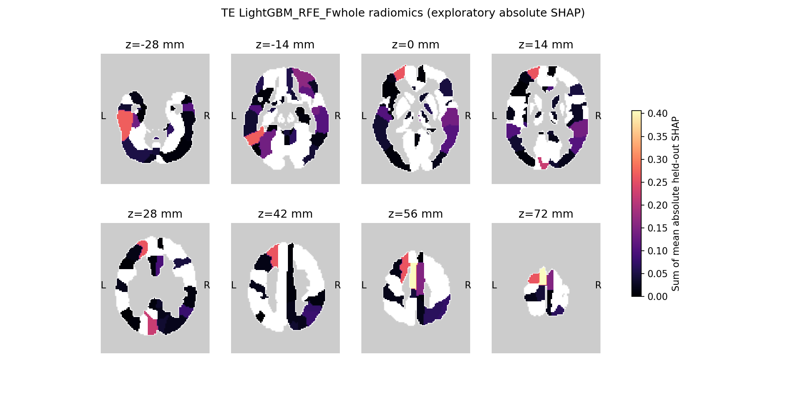

[腦區數值](TE_LightGBM_RFE_Fwhole_radiomics_regions.csv)｜[NIfTI 圖譜](TE_LightGBM_RFE_Fwhole_radiomics_atlas.nii.gz)

### LVO

[全部指標](LVO_summary.csv)｜[逐次 CV 指標](LVO_repeat_metrics.csv)｜[逐人 OOF](LVO_oof_predictions.csv)｜[分類器比較表](LVO_table_4_2_to_4_5.csv)

| 方法 | AUC（conditional 95% CI） | AUPRC | Accuracy | Sensitivity | Specificity | Brier |
|---|---|---:|---:|---:|---:|---:|
| CatBoost_RFE_C | 0.548 [0.461, 0.632] | 0.427 | 0.546 | 0.597 | 0.513 | 0.249 |
| CatBoost_RFE_Fwhole | 0.530 [0.443, 0.609] | 0.436 | 0.561 | 0.390 | 0.672 | 0.248 |
| CatBoost_RFE_R | 0.704 [0.631, 0.777] | 0.577 | 0.653 | 0.597 | 0.689 | 0.232 |
| CatBoost_RFE_S | 0.597 [0.511, 0.680] | 0.451 | 0.668 | 0.468 | 0.798 | 0.244 |
| CatBoost_RFE_T | 0.597 [0.512, 0.682] | 0.487 | 0.648 | 0.299 | 0.874 | 0.244 |
| LightGBM_RFE_C | 0.519 [0.437, 0.600] | 0.427 | 0.510 | 0.364 | 0.605 | 0.255 |
| LightGBM_RFE_Fwhole | 0.582 [0.498, 0.663] | 0.467 | 0.602 | 0.416 | 0.723 | 0.251 |
| LightGBM_RFE_Fwhole_C | 0.565 [0.480, 0.645] | 0.449 | 0.612 | 0.403 | 0.748 | 0.256 |
| LightGBM_RFE_Fwhole_C_R | 0.634 [0.549, 0.714] | 0.508 | 0.633 | 0.416 | 0.773 | 0.237 |
| LightGBM_RFE_Fwhole_C_R_S | 0.629 [0.544, 0.711] | 0.504 | 0.633 | 0.455 | 0.748 | 0.238 |
| LightGBM_RFE_Fwhole_R | 0.638 [0.555, 0.717] | 0.511 | 0.633 | 0.429 | 0.765 | 0.235 |
| LightGBM_RFE_Fwhole_S | 0.571 [0.485, 0.651] | 0.461 | 0.597 | 0.390 | 0.731 | 0.254 |
| LightGBM_RFE_R | 0.720 [0.645, 0.788] | 0.626 | 0.684 | 0.623 | 0.723 | 0.209 |
| LightGBM_RFE_S | 0.643 [0.561, 0.721] | 0.528 | 0.668 | 0.519 | 0.765 | 0.229 |
| LightGBM_RFE_T | 0.608 [0.526, 0.689] | 0.484 | 0.658 | 0.494 | 0.765 | 0.237 |
| LightGBM_RFE_T_C | 0.646 [0.558, 0.724] | 0.595 | 0.689 | 0.481 | 0.824 | 0.223 |
| LightGBM_RFE_T_C_R | 0.749 [0.678, 0.816] | 0.664 | 0.673 | 0.597 | 0.723 | 0.198 |
| LightGBM_RFE_T_C_R_S | 0.734 [0.659, 0.803] | 0.659 | 0.668 | 0.584 | 0.723 | 0.202 |
| LightGBM_RFE_T_R | 0.705 [0.631, 0.776] | 0.594 | 0.673 | 0.584 | 0.731 | 0.214 |
| LightGBM_RFE_T_S | 0.641 [0.558, 0.722] | 0.523 | 0.668 | 0.519 | 0.765 | 0.231 |
| LightGBM_RFE_flags | 0.611 [0.529, 0.692] | 0.486 | 0.653 | 0.494 | 0.756 | 0.237 |
| LightGBM_backward_C | 0.519 [0.437, 0.600] | 0.427 | 0.510 | 0.364 | 0.605 | 0.255 |
| LightGBM_backward_Fwhole | 0.579 [0.490, 0.661] | 0.460 | 0.612 | 0.429 | 0.731 | 0.253 |
| LightGBM_backward_R | 0.724 [0.653, 0.791] | 0.632 | 0.689 | 0.610 | 0.739 | 0.208 |
| LightGBM_backward_S | 0.638 [0.556, 0.717] | 0.526 | 0.663 | 0.519 | 0.756 | 0.230 |
| LightGBM_backward_T | 0.617 [0.534, 0.697] | 0.486 | 0.653 | 0.494 | 0.756 | 0.236 |
| RF_RFE_C | 0.492 [0.410, 0.570] | 0.398 | 0.500 | 0.377 | 0.580 | 0.252 |
| RF_RFE_Fwhole | 0.570 [0.481, 0.654] | 0.482 | 0.617 | 0.442 | 0.731 | 0.247 |
| RF_RFE_R | 0.680 [0.599, 0.756] | 0.555 | 0.617 | 0.571 | 0.647 | 0.222 |
| RF_RFE_S | 0.613 [0.528, 0.695] | 0.481 | 0.628 | 0.403 | 0.773 | 0.235 |
| RF_RFE_T | 0.596 [0.511, 0.678] | 0.480 | 0.617 | 0.325 | 0.807 | 0.241 |
| XGBoost_RFE_C | 0.491 [0.405, 0.573] | 0.402 | 0.526 | 0.416 | 0.597 | 0.259 |
| XGBoost_RFE_Fwhole | 0.605 [0.523, 0.686] | 0.488 | 0.612 | 0.351 | 0.782 | 0.237 |
| XGBoost_RFE_R | 0.677 [0.598, 0.753] | 0.572 | 0.648 | 0.545 | 0.714 | 0.222 |
| XGBoost_RFE_S | 0.594 [0.507, 0.677] | 0.462 | 0.643 | 0.481 | 0.748 | 0.236 |
| XGBoost_RFE_T | 0.628 [0.539, 0.711] | 0.515 | 0.648 | 0.416 | 0.798 | 0.227 |

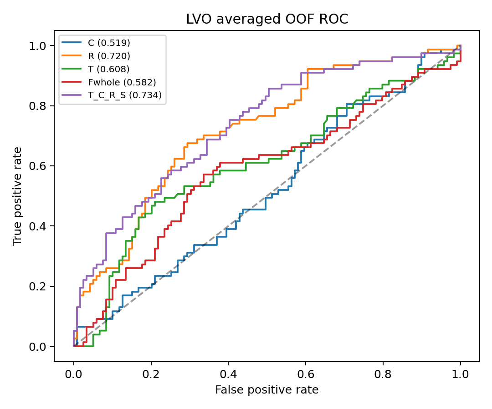

#### C 的 held-out SHAP

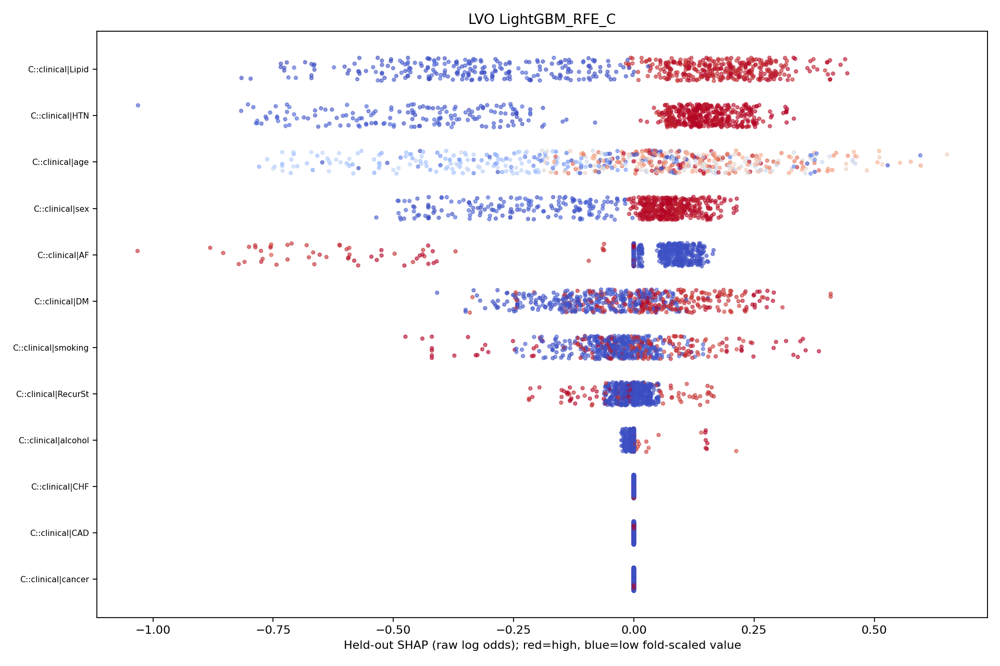

[特徵重要性與入選頻率](LVO_LightGBM_RFE_C_importance.csv)

#### R 的 held-out SHAP

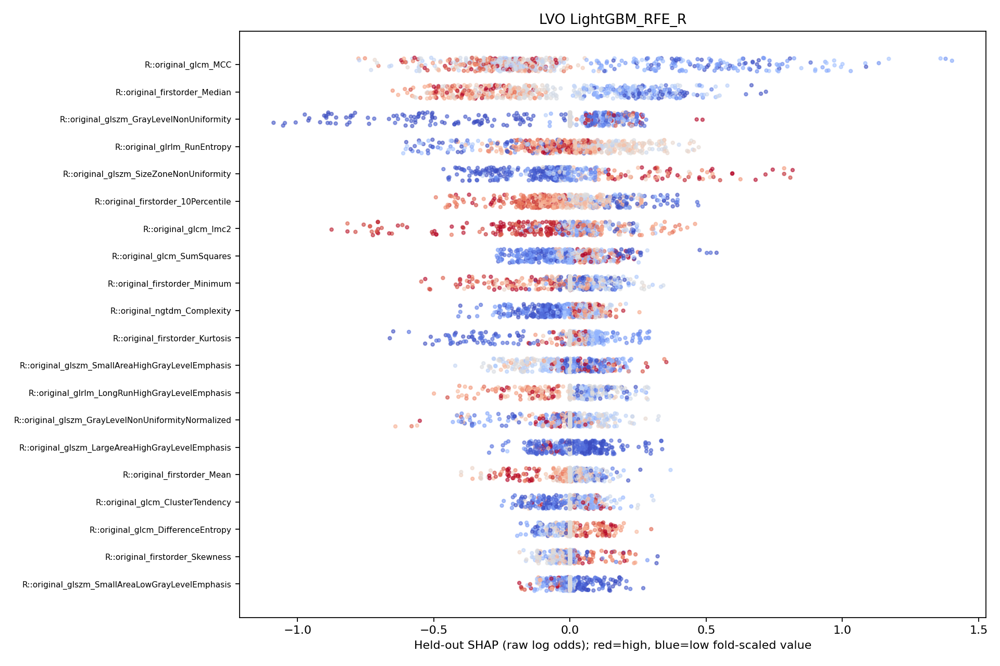

[特徵重要性與入選頻率](LVO_LightGBM_RFE_R_importance.csv)

#### S 的 held-out SHAP

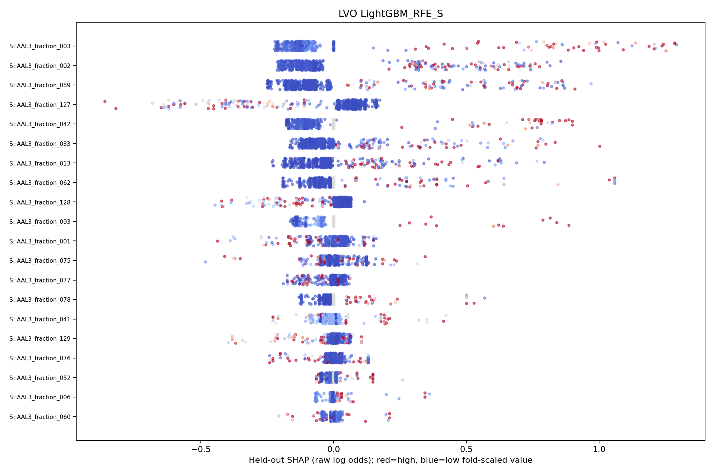

[特徵重要性與入選頻率](LVO_LightGBM_RFE_S_importance.csv)

#### T 的 held-out SHAP

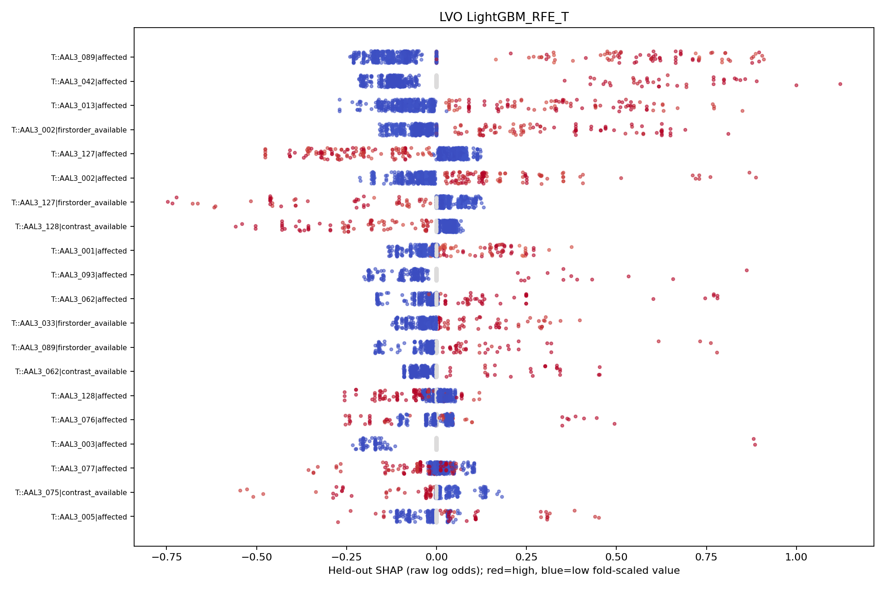

[特徵重要性與入選頻率](LVO_LightGBM_RFE_T_importance.csv)

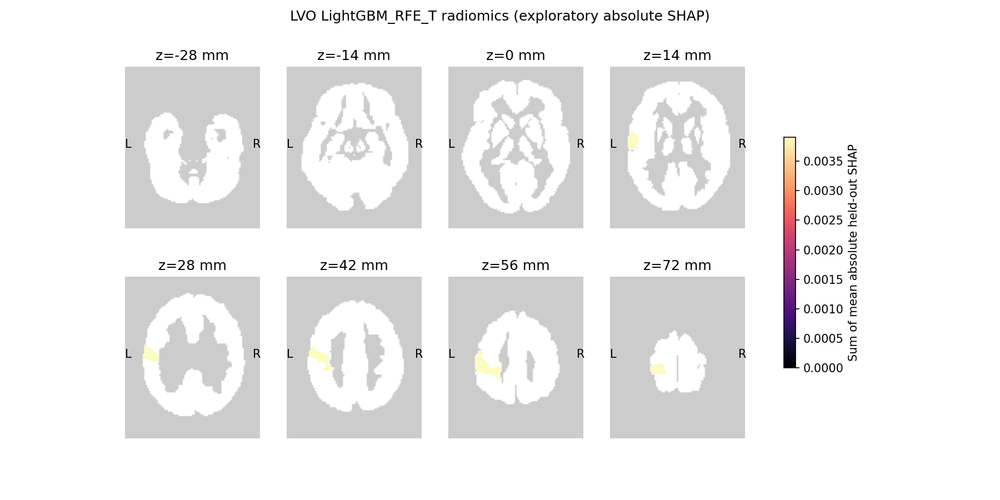

[腦區數值](LVO_LightGBM_RFE_T_radiomics_regions.csv)｜[NIfTI 圖譜](LVO_LightGBM_RFE_T_radiomics_atlas.nii.gz)

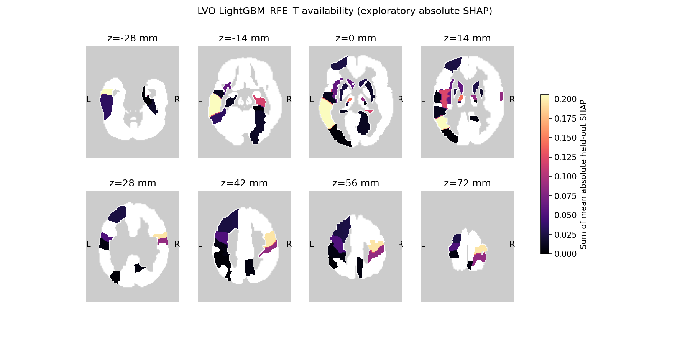

[腦區數值](LVO_LightGBM_RFE_T_availability_regions.csv)｜[NIfTI 圖譜](LVO_LightGBM_RFE_T_availability_atlas.nii.gz)

#### Fwhole 的 held-out SHAP

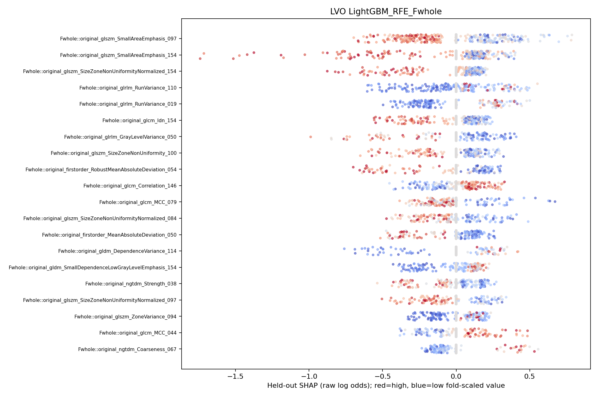

[特徵重要性與入選頻率](LVO_LightGBM_RFE_Fwhole_importance.csv)

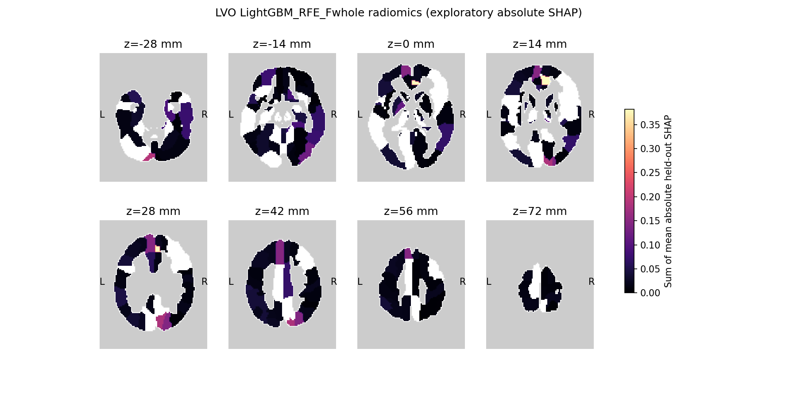

[腦區數值](LVO_LightGBM_RFE_Fwhole_radiomics_regions.csv)｜[NIfTI 圖譜](LVO_LightGBM_RFE_Fwhole_radiomics_atlas.nii.gz)

## 全部圖檔索引

下列亦包含 backward 與融合組合；完整數值檔與圖檔放在同一目錄。

- [LVO_LightGBM_RFE_C_SHAP.png](LVO_LightGBM_RFE_C_SHAP.png)
- [LVO_LightGBM_RFE_Fwhole_C_R_SHAP.png](LVO_LightGBM_RFE_Fwhole_C_R_SHAP.png)
- [LVO_LightGBM_RFE_Fwhole_C_R_S_SHAP.png](LVO_LightGBM_RFE_Fwhole_C_R_S_SHAP.png)
- [LVO_LightGBM_RFE_Fwhole_C_R_S_radiomics_atlas.png](LVO_LightGBM_RFE_Fwhole_C_R_S_radiomics_atlas.png)
- [LVO_LightGBM_RFE_Fwhole_C_R_radiomics_atlas.png](LVO_LightGBM_RFE_Fwhole_C_R_radiomics_atlas.png)
- [LVO_LightGBM_RFE_Fwhole_C_SHAP.png](LVO_LightGBM_RFE_Fwhole_C_SHAP.png)
- [LVO_LightGBM_RFE_Fwhole_C_radiomics_atlas.png](LVO_LightGBM_RFE_Fwhole_C_radiomics_atlas.png)
- [LVO_LightGBM_RFE_Fwhole_R_SHAP.png](LVO_LightGBM_RFE_Fwhole_R_SHAP.png)
- [LVO_LightGBM_RFE_Fwhole_R_radiomics_atlas.png](LVO_LightGBM_RFE_Fwhole_R_radiomics_atlas.png)
- [LVO_LightGBM_RFE_Fwhole_SHAP.png](LVO_LightGBM_RFE_Fwhole_SHAP.png)
- [LVO_LightGBM_RFE_Fwhole_S_SHAP.png](LVO_LightGBM_RFE_Fwhole_S_SHAP.png)
- [LVO_LightGBM_RFE_Fwhole_S_radiomics_atlas.png](LVO_LightGBM_RFE_Fwhole_S_radiomics_atlas.png)
- [LVO_LightGBM_RFE_Fwhole_radiomics_atlas.png](LVO_LightGBM_RFE_Fwhole_radiomics_atlas.png)
- [LVO_LightGBM_RFE_R_SHAP.png](LVO_LightGBM_RFE_R_SHAP.png)
- [LVO_LightGBM_RFE_S_SHAP.png](LVO_LightGBM_RFE_S_SHAP.png)
- [LVO_LightGBM_RFE_T_C_R_SHAP.png](LVO_LightGBM_RFE_T_C_R_SHAP.png)
- [LVO_LightGBM_RFE_T_C_R_S_SHAP.png](LVO_LightGBM_RFE_T_C_R_S_SHAP.png)
- [LVO_LightGBM_RFE_T_C_R_S_availability_atlas.png](LVO_LightGBM_RFE_T_C_R_S_availability_atlas.png)
- [LVO_LightGBM_RFE_T_C_R_S_radiomics_atlas.png](LVO_LightGBM_RFE_T_C_R_S_radiomics_atlas.png)
- [LVO_LightGBM_RFE_T_C_R_availability_atlas.png](LVO_LightGBM_RFE_T_C_R_availability_atlas.png)
- [LVO_LightGBM_RFE_T_C_R_radiomics_atlas.png](LVO_LightGBM_RFE_T_C_R_radiomics_atlas.png)
- [LVO_LightGBM_RFE_T_C_SHAP.png](LVO_LightGBM_RFE_T_C_SHAP.png)
- [LVO_LightGBM_RFE_T_C_availability_atlas.png](LVO_LightGBM_RFE_T_C_availability_atlas.png)
- [LVO_LightGBM_RFE_T_C_radiomics_atlas.png](LVO_LightGBM_RFE_T_C_radiomics_atlas.png)
- [LVO_LightGBM_RFE_T_R_SHAP.png](LVO_LightGBM_RFE_T_R_SHAP.png)
- [LVO_LightGBM_RFE_T_R_availability_atlas.png](LVO_LightGBM_RFE_T_R_availability_atlas.png)
- [LVO_LightGBM_RFE_T_R_radiomics_atlas.png](LVO_LightGBM_RFE_T_R_radiomics_atlas.png)
- [LVO_LightGBM_RFE_T_SHAP.png](LVO_LightGBM_RFE_T_SHAP.png)
- [LVO_LightGBM_RFE_T_S_SHAP.png](LVO_LightGBM_RFE_T_S_SHAP.png)
- [LVO_LightGBM_RFE_T_S_availability_atlas.png](LVO_LightGBM_RFE_T_S_availability_atlas.png)
- [LVO_LightGBM_RFE_T_S_radiomics_atlas.png](LVO_LightGBM_RFE_T_S_radiomics_atlas.png)
- [LVO_LightGBM_RFE_T_availability_atlas.png](LVO_LightGBM_RFE_T_availability_atlas.png)
- [LVO_LightGBM_RFE_T_radiomics_atlas.png](LVO_LightGBM_RFE_T_radiomics_atlas.png)
- [LVO_LightGBM_RFE_flags_SHAP.png](LVO_LightGBM_RFE_flags_SHAP.png)
- [LVO_LightGBM_RFE_flags_availability_atlas.png](LVO_LightGBM_RFE_flags_availability_atlas.png)
- [LVO_LightGBM_backward_C_SHAP.png](LVO_LightGBM_backward_C_SHAP.png)
- [LVO_LightGBM_backward_Fwhole_SHAP.png](LVO_LightGBM_backward_Fwhole_SHAP.png)
- [LVO_LightGBM_backward_Fwhole_radiomics_atlas.png](LVO_LightGBM_backward_Fwhole_radiomics_atlas.png)
- [LVO_LightGBM_backward_R_SHAP.png](LVO_LightGBM_backward_R_SHAP.png)
- [LVO_LightGBM_backward_S_SHAP.png](LVO_LightGBM_backward_S_SHAP.png)
- [LVO_LightGBM_backward_T_SHAP.png](LVO_LightGBM_backward_T_SHAP.png)
- [LVO_LightGBM_backward_T_availability_atlas.png](LVO_LightGBM_backward_T_availability_atlas.png)
- [LVO_LightGBM_backward_T_radiomics_atlas.png](LVO_LightGBM_backward_T_radiomics_atlas.png)
- [LVO_ROC.png](LVO_ROC.png)
- [NIHSS_LightGBM_RFE_C_SHAP.png](NIHSS_LightGBM_RFE_C_SHAP.png)
- [NIHSS_LightGBM_RFE_Fwhole_C_R_SHAP.png](NIHSS_LightGBM_RFE_Fwhole_C_R_SHAP.png)
- [NIHSS_LightGBM_RFE_Fwhole_C_R_S_SHAP.png](NIHSS_LightGBM_RFE_Fwhole_C_R_S_SHAP.png)
- [NIHSS_LightGBM_RFE_Fwhole_C_R_S_radiomics_atlas.png](NIHSS_LightGBM_RFE_Fwhole_C_R_S_radiomics_atlas.png)
- [NIHSS_LightGBM_RFE_Fwhole_C_R_radiomics_atlas.png](NIHSS_LightGBM_RFE_Fwhole_C_R_radiomics_atlas.png)
- [NIHSS_LightGBM_RFE_Fwhole_C_SHAP.png](NIHSS_LightGBM_RFE_Fwhole_C_SHAP.png)
- [NIHSS_LightGBM_RFE_Fwhole_C_radiomics_atlas.png](NIHSS_LightGBM_RFE_Fwhole_C_radiomics_atlas.png)
- [NIHSS_LightGBM_RFE_Fwhole_R_SHAP.png](NIHSS_LightGBM_RFE_Fwhole_R_SHAP.png)
- [NIHSS_LightGBM_RFE_Fwhole_R_radiomics_atlas.png](NIHSS_LightGBM_RFE_Fwhole_R_radiomics_atlas.png)
- [NIHSS_LightGBM_RFE_Fwhole_SHAP.png](NIHSS_LightGBM_RFE_Fwhole_SHAP.png)
- [NIHSS_LightGBM_RFE_Fwhole_S_SHAP.png](NIHSS_LightGBM_RFE_Fwhole_S_SHAP.png)
- [NIHSS_LightGBM_RFE_Fwhole_S_radiomics_atlas.png](NIHSS_LightGBM_RFE_Fwhole_S_radiomics_atlas.png)
- [NIHSS_LightGBM_RFE_Fwhole_radiomics_atlas.png](NIHSS_LightGBM_RFE_Fwhole_radiomics_atlas.png)
- [NIHSS_LightGBM_RFE_R_SHAP.png](NIHSS_LightGBM_RFE_R_SHAP.png)
- [NIHSS_LightGBM_RFE_S_SHAP.png](NIHSS_LightGBM_RFE_S_SHAP.png)
- [NIHSS_LightGBM_RFE_T_C_R_SHAP.png](NIHSS_LightGBM_RFE_T_C_R_SHAP.png)
- [NIHSS_LightGBM_RFE_T_C_R_S_SHAP.png](NIHSS_LightGBM_RFE_T_C_R_S_SHAP.png)
- [NIHSS_LightGBM_RFE_T_C_R_S_availability_atlas.png](NIHSS_LightGBM_RFE_T_C_R_S_availability_atlas.png)
- [NIHSS_LightGBM_RFE_T_C_R_S_radiomics_atlas.png](NIHSS_LightGBM_RFE_T_C_R_S_radiomics_atlas.png)
- [NIHSS_LightGBM_RFE_T_C_R_availability_atlas.png](NIHSS_LightGBM_RFE_T_C_R_availability_atlas.png)
- [NIHSS_LightGBM_RFE_T_C_R_radiomics_atlas.png](NIHSS_LightGBM_RFE_T_C_R_radiomics_atlas.png)
- [NIHSS_LightGBM_RFE_T_C_SHAP.png](NIHSS_LightGBM_RFE_T_C_SHAP.png)
- [NIHSS_LightGBM_RFE_T_C_availability_atlas.png](NIHSS_LightGBM_RFE_T_C_availability_atlas.png)
- [NIHSS_LightGBM_RFE_T_C_radiomics_atlas.png](NIHSS_LightGBM_RFE_T_C_radiomics_atlas.png)
- [NIHSS_LightGBM_RFE_T_R_SHAP.png](NIHSS_LightGBM_RFE_T_R_SHAP.png)
- [NIHSS_LightGBM_RFE_T_R_availability_atlas.png](NIHSS_LightGBM_RFE_T_R_availability_atlas.png)
- [NIHSS_LightGBM_RFE_T_R_radiomics_atlas.png](NIHSS_LightGBM_RFE_T_R_radiomics_atlas.png)
- [NIHSS_LightGBM_RFE_T_SHAP.png](NIHSS_LightGBM_RFE_T_SHAP.png)
- [NIHSS_LightGBM_RFE_T_S_SHAP.png](NIHSS_LightGBM_RFE_T_S_SHAP.png)
- [NIHSS_LightGBM_RFE_T_S_availability_atlas.png](NIHSS_LightGBM_RFE_T_S_availability_atlas.png)
- [NIHSS_LightGBM_RFE_T_S_radiomics_atlas.png](NIHSS_LightGBM_RFE_T_S_radiomics_atlas.png)
- [NIHSS_LightGBM_RFE_T_availability_atlas.png](NIHSS_LightGBM_RFE_T_availability_atlas.png)
- [NIHSS_LightGBM_RFE_T_radiomics_atlas.png](NIHSS_LightGBM_RFE_T_radiomics_atlas.png)
- [NIHSS_LightGBM_RFE_flags_SHAP.png](NIHSS_LightGBM_RFE_flags_SHAP.png)
- [NIHSS_LightGBM_RFE_flags_availability_atlas.png](NIHSS_LightGBM_RFE_flags_availability_atlas.png)
- [NIHSS_LightGBM_backward_C_SHAP.png](NIHSS_LightGBM_backward_C_SHAP.png)
- [NIHSS_LightGBM_backward_Fwhole_SHAP.png](NIHSS_LightGBM_backward_Fwhole_SHAP.png)
- [NIHSS_LightGBM_backward_Fwhole_radiomics_atlas.png](NIHSS_LightGBM_backward_Fwhole_radiomics_atlas.png)
- [NIHSS_LightGBM_backward_R_SHAP.png](NIHSS_LightGBM_backward_R_SHAP.png)
- [NIHSS_LightGBM_backward_S_SHAP.png](NIHSS_LightGBM_backward_S_SHAP.png)
- [NIHSS_LightGBM_backward_T_SHAP.png](NIHSS_LightGBM_backward_T_SHAP.png)
- [NIHSS_LightGBM_backward_T_availability_atlas.png](NIHSS_LightGBM_backward_T_availability_atlas.png)
- [NIHSS_LightGBM_backward_T_radiomics_atlas.png](NIHSS_LightGBM_backward_T_radiomics_atlas.png)
- [NIHSS_ROC.png](NIHSS_ROC.png)
- [TE_LightGBM_RFE_C_SHAP.png](TE_LightGBM_RFE_C_SHAP.png)
- [TE_LightGBM_RFE_Fwhole_C_R_SHAP.png](TE_LightGBM_RFE_Fwhole_C_R_SHAP.png)
- [TE_LightGBM_RFE_Fwhole_C_R_S_SHAP.png](TE_LightGBM_RFE_Fwhole_C_R_S_SHAP.png)
- [TE_LightGBM_RFE_Fwhole_C_R_S_radiomics_atlas.png](TE_LightGBM_RFE_Fwhole_C_R_S_radiomics_atlas.png)
- [TE_LightGBM_RFE_Fwhole_C_R_radiomics_atlas.png](TE_LightGBM_RFE_Fwhole_C_R_radiomics_atlas.png)
- [TE_LightGBM_RFE_Fwhole_C_SHAP.png](TE_LightGBM_RFE_Fwhole_C_SHAP.png)
- [TE_LightGBM_RFE_Fwhole_C_radiomics_atlas.png](TE_LightGBM_RFE_Fwhole_C_radiomics_atlas.png)
- [TE_LightGBM_RFE_Fwhole_R_SHAP.png](TE_LightGBM_RFE_Fwhole_R_SHAP.png)
- [TE_LightGBM_RFE_Fwhole_R_radiomics_atlas.png](TE_LightGBM_RFE_Fwhole_R_radiomics_atlas.png)
- [TE_LightGBM_RFE_Fwhole_SHAP.png](TE_LightGBM_RFE_Fwhole_SHAP.png)
- [TE_LightGBM_RFE_Fwhole_S_SHAP.png](TE_LightGBM_RFE_Fwhole_S_SHAP.png)
- [TE_LightGBM_RFE_Fwhole_S_radiomics_atlas.png](TE_LightGBM_RFE_Fwhole_S_radiomics_atlas.png)
- [TE_LightGBM_RFE_Fwhole_radiomics_atlas.png](TE_LightGBM_RFE_Fwhole_radiomics_atlas.png)
- [TE_LightGBM_RFE_R_SHAP.png](TE_LightGBM_RFE_R_SHAP.png)
- [TE_LightGBM_RFE_S_SHAP.png](TE_LightGBM_RFE_S_SHAP.png)
- [TE_LightGBM_RFE_T_C_R_SHAP.png](TE_LightGBM_RFE_T_C_R_SHAP.png)
- [TE_LightGBM_RFE_T_C_R_S_SHAP.png](TE_LightGBM_RFE_T_C_R_S_SHAP.png)
- [TE_LightGBM_RFE_T_C_R_S_availability_atlas.png](TE_LightGBM_RFE_T_C_R_S_availability_atlas.png)
- [TE_LightGBM_RFE_T_C_R_S_radiomics_atlas.png](TE_LightGBM_RFE_T_C_R_S_radiomics_atlas.png)
- [TE_LightGBM_RFE_T_C_R_availability_atlas.png](TE_LightGBM_RFE_T_C_R_availability_atlas.png)
- [TE_LightGBM_RFE_T_C_R_radiomics_atlas.png](TE_LightGBM_RFE_T_C_R_radiomics_atlas.png)
- [TE_LightGBM_RFE_T_C_SHAP.png](TE_LightGBM_RFE_T_C_SHAP.png)
- [TE_LightGBM_RFE_T_C_availability_atlas.png](TE_LightGBM_RFE_T_C_availability_atlas.png)
- [TE_LightGBM_RFE_T_C_radiomics_atlas.png](TE_LightGBM_RFE_T_C_radiomics_atlas.png)
- [TE_LightGBM_RFE_T_R_SHAP.png](TE_LightGBM_RFE_T_R_SHAP.png)
- [TE_LightGBM_RFE_T_R_availability_atlas.png](TE_LightGBM_RFE_T_R_availability_atlas.png)
- [TE_LightGBM_RFE_T_R_radiomics_atlas.png](TE_LightGBM_RFE_T_R_radiomics_atlas.png)
- [TE_LightGBM_RFE_T_SHAP.png](TE_LightGBM_RFE_T_SHAP.png)
- [TE_LightGBM_RFE_T_S_SHAP.png](TE_LightGBM_RFE_T_S_SHAP.png)
- [TE_LightGBM_RFE_T_S_availability_atlas.png](TE_LightGBM_RFE_T_S_availability_atlas.png)
- [TE_LightGBM_RFE_T_S_radiomics_atlas.png](TE_LightGBM_RFE_T_S_radiomics_atlas.png)
- [TE_LightGBM_RFE_T_availability_atlas.png](TE_LightGBM_RFE_T_availability_atlas.png)
- [TE_LightGBM_RFE_T_radiomics_atlas.png](TE_LightGBM_RFE_T_radiomics_atlas.png)
- [TE_LightGBM_RFE_flags_SHAP.png](TE_LightGBM_RFE_flags_SHAP.png)
- [TE_LightGBM_RFE_flags_availability_atlas.png](TE_LightGBM_RFE_flags_availability_atlas.png)
- [TE_LightGBM_backward_C_SHAP.png](TE_LightGBM_backward_C_SHAP.png)
- [TE_LightGBM_backward_Fwhole_SHAP.png](TE_LightGBM_backward_Fwhole_SHAP.png)
- [TE_LightGBM_backward_Fwhole_radiomics_atlas.png](TE_LightGBM_backward_Fwhole_radiomics_atlas.png)
- [TE_LightGBM_backward_R_SHAP.png](TE_LightGBM_backward_R_SHAP.png)
- [TE_LightGBM_backward_S_SHAP.png](TE_LightGBM_backward_S_SHAP.png)
- [TE_LightGBM_backward_T_SHAP.png](TE_LightGBM_backward_T_SHAP.png)
- [TE_LightGBM_backward_T_availability_atlas.png](TE_LightGBM_backward_T_availability_atlas.png)
- [TE_LightGBM_backward_T_radiomics_atlas.png](TE_LightGBM_backward_T_radiomics_atlas.png)
- [TE_ROC.png](TE_ROC.png)
- [mRS_LightGBM_RFE_C_SHAP.png](mRS_LightGBM_RFE_C_SHAP.png)
- [mRS_LightGBM_RFE_Fwhole_C_R_SHAP.png](mRS_LightGBM_RFE_Fwhole_C_R_SHAP.png)
- [mRS_LightGBM_RFE_Fwhole_C_R_S_SHAP.png](mRS_LightGBM_RFE_Fwhole_C_R_S_SHAP.png)
- [mRS_LightGBM_RFE_Fwhole_C_R_S_radiomics_atlas.png](mRS_LightGBM_RFE_Fwhole_C_R_S_radiomics_atlas.png)
- [mRS_LightGBM_RFE_Fwhole_C_R_radiomics_atlas.png](mRS_LightGBM_RFE_Fwhole_C_R_radiomics_atlas.png)
- [mRS_LightGBM_RFE_Fwhole_C_SHAP.png](mRS_LightGBM_RFE_Fwhole_C_SHAP.png)
- [mRS_LightGBM_RFE_Fwhole_C_radiomics_atlas.png](mRS_LightGBM_RFE_Fwhole_C_radiomics_atlas.png)
- [mRS_LightGBM_RFE_Fwhole_R_SHAP.png](mRS_LightGBM_RFE_Fwhole_R_SHAP.png)
- [mRS_LightGBM_RFE_Fwhole_R_radiomics_atlas.png](mRS_LightGBM_RFE_Fwhole_R_radiomics_atlas.png)
- [mRS_LightGBM_RFE_Fwhole_SHAP.png](mRS_LightGBM_RFE_Fwhole_SHAP.png)
- [mRS_LightGBM_RFE_Fwhole_S_SHAP.png](mRS_LightGBM_RFE_Fwhole_S_SHAP.png)
- [mRS_LightGBM_RFE_Fwhole_S_radiomics_atlas.png](mRS_LightGBM_RFE_Fwhole_S_radiomics_atlas.png)
- [mRS_LightGBM_RFE_Fwhole_radiomics_atlas.png](mRS_LightGBM_RFE_Fwhole_radiomics_atlas.png)
- [mRS_LightGBM_RFE_R_SHAP.png](mRS_LightGBM_RFE_R_SHAP.png)
- [mRS_LightGBM_RFE_S_SHAP.png](mRS_LightGBM_RFE_S_SHAP.png)
- [mRS_LightGBM_RFE_T_C_R_SHAP.png](mRS_LightGBM_RFE_T_C_R_SHAP.png)
- [mRS_LightGBM_RFE_T_C_R_S_SHAP.png](mRS_LightGBM_RFE_T_C_R_S_SHAP.png)
- [mRS_LightGBM_RFE_T_C_R_S_availability_atlas.png](mRS_LightGBM_RFE_T_C_R_S_availability_atlas.png)
- [mRS_LightGBM_RFE_T_C_R_S_radiomics_atlas.png](mRS_LightGBM_RFE_T_C_R_S_radiomics_atlas.png)
- [mRS_LightGBM_RFE_T_C_R_availability_atlas.png](mRS_LightGBM_RFE_T_C_R_availability_atlas.png)
- [mRS_LightGBM_RFE_T_C_R_radiomics_atlas.png](mRS_LightGBM_RFE_T_C_R_radiomics_atlas.png)
- [mRS_LightGBM_RFE_T_C_SHAP.png](mRS_LightGBM_RFE_T_C_SHAP.png)
- [mRS_LightGBM_RFE_T_C_availability_atlas.png](mRS_LightGBM_RFE_T_C_availability_atlas.png)
- [mRS_LightGBM_RFE_T_C_radiomics_atlas.png](mRS_LightGBM_RFE_T_C_radiomics_atlas.png)
- [mRS_LightGBM_RFE_T_R_SHAP.png](mRS_LightGBM_RFE_T_R_SHAP.png)
- [mRS_LightGBM_RFE_T_R_availability_atlas.png](mRS_LightGBM_RFE_T_R_availability_atlas.png)
- [mRS_LightGBM_RFE_T_R_radiomics_atlas.png](mRS_LightGBM_RFE_T_R_radiomics_atlas.png)
- [mRS_LightGBM_RFE_T_SHAP.png](mRS_LightGBM_RFE_T_SHAP.png)
- [mRS_LightGBM_RFE_T_S_SHAP.png](mRS_LightGBM_RFE_T_S_SHAP.png)
- [mRS_LightGBM_RFE_T_S_availability_atlas.png](mRS_LightGBM_RFE_T_S_availability_atlas.png)
- [mRS_LightGBM_RFE_T_S_radiomics_atlas.png](mRS_LightGBM_RFE_T_S_radiomics_atlas.png)
- [mRS_LightGBM_RFE_T_availability_atlas.png](mRS_LightGBM_RFE_T_availability_atlas.png)
- [mRS_LightGBM_RFE_T_radiomics_atlas.png](mRS_LightGBM_RFE_T_radiomics_atlas.png)
- [mRS_LightGBM_RFE_flags_SHAP.png](mRS_LightGBM_RFE_flags_SHAP.png)
- [mRS_LightGBM_RFE_flags_availability_atlas.png](mRS_LightGBM_RFE_flags_availability_atlas.png)
- [mRS_LightGBM_backward_C_SHAP.png](mRS_LightGBM_backward_C_SHAP.png)
- [mRS_LightGBM_backward_Fwhole_SHAP.png](mRS_LightGBM_backward_Fwhole_SHAP.png)
- [mRS_LightGBM_backward_Fwhole_radiomics_atlas.png](mRS_LightGBM_backward_Fwhole_radiomics_atlas.png)
- [mRS_LightGBM_backward_R_SHAP.png](mRS_LightGBM_backward_R_SHAP.png)
- [mRS_LightGBM_backward_S_SHAP.png](mRS_LightGBM_backward_S_SHAP.png)
- [mRS_LightGBM_backward_T_SHAP.png](mRS_LightGBM_backward_T_SHAP.png)
- [mRS_LightGBM_backward_T_availability_atlas.png](mRS_LightGBM_backward_T_availability_atlas.png)
- [mRS_LightGBM_backward_T_radiomics_atlas.png](mRS_LightGBM_backward_T_radiomics_atlas.png)
- [mRS_ROC.png](mRS_ROC.png)
